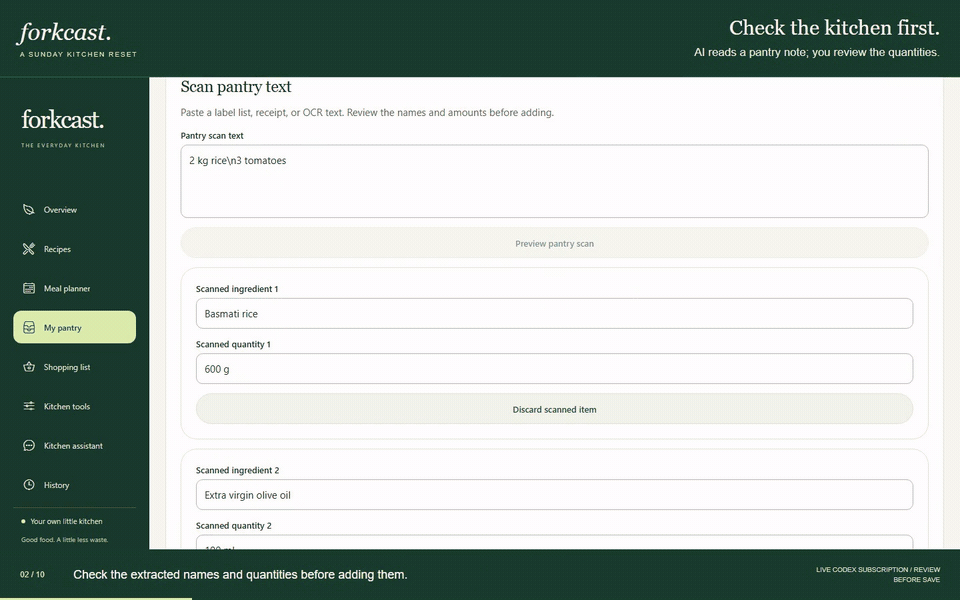

# Forkcast

Plan meals, use what is in your pantry, and turn recipes into one shopping list.
Forkcast runs locally with SQLite. AI can help import recipes, read pantry notes
and flyers, and prepare kitchen tasks for review.

[](docs/forkcast-overview.mp4)

[Watch the product overview — elevenlabs.io (2:51)](docs/forkcast-overview.mp4) ·
[Follow the complete kitchen walkthrough — elevenlabs.io (14:35)](docs/forkcast-walkthrough.mp4)

Both videos include narration. The walkthrough follows an example household
from a Sunday pantry check to a meal plan and shopping trip, with the mobile
shopping flow shown inside a phone frame. The flyer scan uses
[FreshCo's Ontario flyer](https://flipp.com/en-ca/scarborough-on/flyer/8180944-freshco-diwali-low-prices),
valid October 15–November 11, 2026, alongside a Food Basics offer valid through
October 21. Recorded offers include expiry dates; model results and mapped stores
come from the running app. Phone footage demonstrates the responsive browser app.
English captions: [overview](docs/forkcast-overview.vtt) ·
[walkthrough](docs/forkcast-walkthrough.vtt).

## Features

| Workflow          | What you can do                                                                                                                                |
| ----------------- | ---------------------------------------------------------------------------------------------------------------------------------------------- |
| Recipes           | Browse 50 sourced halal adaptations with local photographs; add and edit personal recipes; import text, JSON or YouTube descriptions/captions. |
| Pantry            | Record stock quantities, review extracted text/images, and find recipes that use what you have.                                                |
| Planning          | Create and share meal plans, or ask the assistant to prepare a plan and review it before applying.                                             |
| Shopping          | Combine compatible ingredient quantities, deduct pantry stock, inspect recipe evidence, check off items, export lists and keep history.        |
| Prices and stores | Record flyer offers, compare whole-pack costs, identify unpriced items and find mapped grocery stores near a chosen location.                  |
| Optional AI       | Use a signed-in Codex/Claude CLI or OpenAI, Anthropic or Google API. Extraction produces editable previews; assistant changes require Apply.   |

The interface supports desktop and phone-sized browsers. Recipes, plans, pantry,
shopping history and recorded-offer comparisons need no cloud account. Model
requests, video fetching and map searches need access to their respective services.

## Run locally

Requirements: Python 3.11+, Node 22.13+ (22.x) or 24.3+ (24.x), and npm.

Create a backend environment:

```sh
cd backend
python -m venv .venv
```

Activate it with `source .venv/bin/activate` on macOS/Linux, or
`.\.venv\Scripts\Activate.ps1` in Windows PowerShell. Then start the API:

```sh
python -m pip install -r requirements.txt
python -m uvicorn main:app --host 127.0.0.1 --port 8000
```

In a second terminal:

```sh
cd app
npm ci
npm run web
```

Open the address printed by Expo, usually `http://localhost:8081`.
The backend creates and seeds the local database on startup. No environment file
is needed for the default setup. The API exposes
[interactive endpoint documentation](http://localhost:8000/docs) and
[a health check](http://localhost:8000/api/health).

`npm run build:web` exports the client to `app/dist`. For a phone on a trusted LAN,
set `EXPO_PUBLIC_API_URL` to the computer's LAN address plus `:8000/api`, bind the
backend to that interface, and allow the browser origin with `FORKCAST_ORIGINS`.
This installation has no user authentication; do not expose it directly to the
public internet. The current browser app needs access to the local API to load
household data.

## Configure AI

Open **Chat → Model settings** to choose an available provider, or set these
variables on the backend before starting it:

| Mode                | `FORKCAST_MODEL_PROVIDER` | Configuration                                          |
| ------------------- | ------------------------- | ------------------------------------------------------ |
| Codex subscription  | `codex`                   | Installed Codex CLI, signed in with your account       |
| Claude subscription | `claude`                  | Installed Claude Code CLI, signed in with your account |
| OpenAI API          | `openai`                  | `OPENAI_API_KEY` and `FORKCAST_MODEL`                  |
| Anthropic API       | `anthropic`               | `ANTHROPIC_API_KEY` and `FORKCAST_MODEL`               |
| Google API          | `google`                  | `GOOGLE_API_KEY` and `FORKCAST_MODEL`                  |

The default is `none`; CLI modes can use their configured default model. An
explicit backend `FORKCAST_MODEL_PROVIDER` overrides the in-app selection.
Codex and the vision API adapters accept JPEG, PNG and WebP images up to 5 MB;
Claude CLI accepts text.

Submitted extraction material goes to the chosen provider. The assistant also
receives relevant recipes, pantry, plans and recent conversation. API keys stay
on the server; never put them in `EXPO_PUBLIC_` variables. Source content and
model output need review before saving. Optional TypeSafe Jev ingredient review
is configured with `FORKCAST_DECISION_PROVIDER=jev` and `TYPESAFE_API_KEY`.

## Data and backups

Household records live in `data/local/forkcast.sqlite3`, or the path selected by
`FORKCAST_DATABASE`. Personal recipes, edits, plans, pantry, conversations and
offers stay separate from the committed reference catalog. Startup updates
reference data while preserving household records.

Create a consistent backup with a new destination path:

```sh
python scripts/backup.py /path/to/household-backup.sqlite3
```

Keep backups private. Databases, credentials and runtime files are ignored by Git.
Recipe sources and image credits are documented in [the dataset guide](datasets/README.md).

## Development

- [Architecture](docs/ARCHITECTURE.md): components, storage model, grocery pipeline and assistant transactions.
- [Contributing](CONTRIBUTING.md): development checks, catalog changes and dependency maintenance.
- [Dataset and attribution](datasets/README.md): recipe sources and photograph licenses.

The app uses Expo 58, React 19.3, React Native 0.88, FastAPI and SQLite.
The assistant uses LangGraph. Native builds need their platform toolchains;
browser responsiveness and bundle export do not establish device compatibility.

## License

[MIT](LICENSE) for the application code. Bundled photographs retain the licenses
listed in [their credit manifest](datasets/photo-credits.json).
The video narration is credited to elevenlabs.io and is shared for noncommercial
use under [ElevenLabs' publication terms](https://help.elevenlabs.io/hc/en-us/articles/13313564601361-Can-I-publish-the-content-I-generate-on-the-platform).
