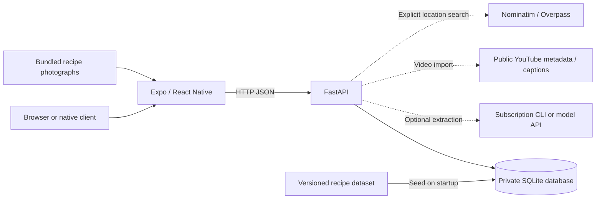
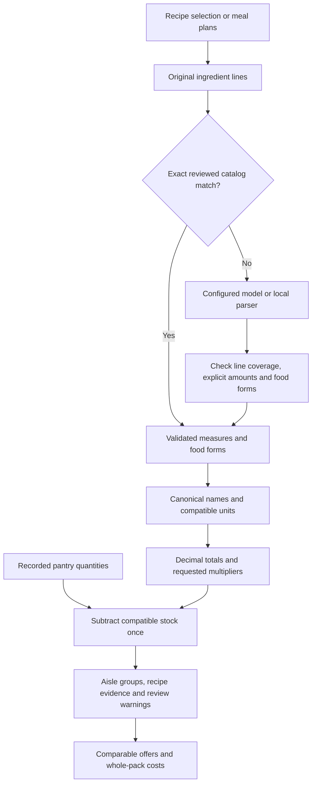
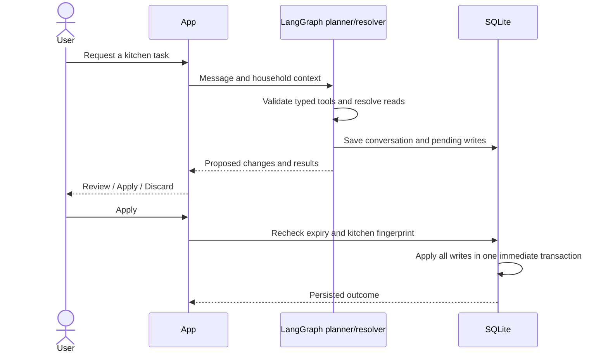

# Architecture

Forkcast is a single-household application: an Expo client talks to a local
FastAPI service, which owns a SQLite database. Recipe management, meal planning,
pantry deductions and recorded-price comparisons run without a cloud account.
Model providers and public data sources extend those workflows when configured.

## System boundaries

The client never holds provider API keys. SQLite remains the source of truth for
household records; there is no automatic upload to the reference dataset or a
hosted database. Opening a reference photo makes no external request.

| Component                                                                                  | Responsibility                                                                   |
| ------------------------------------------------------------------------------------------ | -------------------------------------------------------------------------------- |
| [`app/src/context/HouseholdContext.tsx`](../app/src/context/HouseholdContext.tsx)          | Shared client view of recipes, pantry, plans and history; refresh after writes   |
| [`app/src/lib/api.ts`](../app/src/lib/api.ts)                                              | Configured API address, JSON requests and error handling                         |
| [`backend/main.py`](../backend/main.py)                                                    | HTTP routes, input validation, household operations and browser-origin policy    |
| [`backend/database.py`](../backend/database.py)                                            | Schema initialization, reference refresh and transactional record persistence    |
| [`backend/groceries.py`](../backend/groceries.py)                                          | Ingredient interpretation, source checks, totals, pantry deductions and evidence |
| [`backend/assistant.py`](../backend/assistant.py)                                          | Typed LangGraph planning, task previews and atomic Apply/cancel                  |
| [`backend/providers.py`](../backend/providers.py)                                          | Optional model adapters, output schemas and isolated subscription requests       |
| [`backend/youtube.py`](../backend/youtube.py), [`backend/stores.py`](../backend/stores.py) | Bounded source fetching and attributed public results                            |

## Data model and lifecycle

The default database is `data/local/forkcast.sqlite3`; `FORKCAST_DATABASE` selects
another path. Each operation opens a connection with foreign keys enabled and a
15-second busy timeout. Startup enables WAL and seeds the reference tables inside
the FastAPI lifespan. Transactions close before the connection is released.

| Table                | Key          | Contents                                                   |
| -------------------- | ------------ | ---------------------------------------------------------- |
| `migrations`         | `version`    | Applied schema/catalog migrations                          |
| `catalog_recipes`    | `id`         | Versioned reference recipe JSON                            |
| `parsed_ingredients` | `recipe_id`  | Reviewed ingredient rows; foreign key to `catalog_recipes` |
| `ingredient_lookup`  | `canonical`  | Ingredient aliases and grocery categories                  |
| `records`            | `(kind, id)` | Private JSON records with a creation timestamp             |

Record kinds include recipes, pantry stock, plans, saved grocery lists, offers,
conversations, assistant tasks, interpretation caches and store-search caches.
Recipe IDs inside plans are logical JSON references validated by the API.

`datasets/catalog.json` is committed reference data. Initialization refreshes its
tables while retaining private records. A personal edit of a reference recipe is
stored as an override under the same ID. Reads combine the catalog and overrides;
deleting an override reveals the original. Removing a custom recipe also removes
its references from plans. Recipes from a retired catalog that an existing plan
uses are preserved as explicitly unreviewed personal records.

Photographs use static Metro imports generated from
`datasets/photo-credits.json`. This bundles the assets for web and native exports
and keeps the photographer/license information attached to each reference image.

## From recipes to a shopping list

Reviewed catalog rows are authoritative when their raw text matches the current
recipe line. A personal edit therefore uses its current ingredients rather than
stale prepared rows. Model interpretation must cover every ingredient index once,
preserve explicit quantities and retain distinctions such as raw/cooked,
fresh/dried and meat cuts. Cached interpretations are keyed by ingredient content,
provider, model and pipeline version. Optional TypeSafe Jev review adds uncertainty
flags at the interpretation boundary.

Arithmetic stays local. Weight, volume and counts remain separate; the app does
not infer density, can weights or lemon yields. Measured stock is deducted only
with compatible units. An empty stock quantity means sufficient supply. Unknown
amounts and incompatible stock remain visible for review. Purchase items retain
the originating recipe lines and applied multipliers.

Offer comparison excludes expired records and other currencies, rounds purchases
up to whole packs, and reports unpriced lines separately. It does not optimize
travel, combine multiple pack sizes or establish current retailer stock.

## Model requests and assistant changes

The default provider is disabled. OpenAI, Anthropic and Google adapters use server
environment keys. Codex and Claude use the operator's signed-in local CLI;
API-key variables are removed from those child processes. Requests use isolated
temporary directories, disabled tools, a timeout and one model request at a time
per server process. Structured results are validated before the API returns them.

Recipe, pantry and flyer extraction return previews. The user saves reviewed
data through the normal household endpoints. Grocery interpretation can run in
automatic, local or model mode; it receives the selected recipe ingredients.
Assistant requests include relevant kitchen state and recent conversation.

The tool set covers pantry additions, meal plans, groceries, offer comparisons,
YouTube import and explicitly requested store lookup. It does not expose a shell,
arbitrary URL browsing, ordering or record deletion. Pending tasks expire after
one hour and fail if the kitchen changed. Applied or cancelled tasks are
idempotent. LangSmith tracing is disabled in the workflow.

## External sources

YouTube import accepts recognized video URL forms and fetches available public
descriptions/captions. It does not download the video or use account cookies.
Unavailable or blocked content can be supplied as pasted text. Source links,
creator information and extraction warnings accompany the preview.

Store lookup sends an explicitly supplied location to Nominatim and Overpass.
Requests have size/time limits and bounded fallbacks; results are cached privately
for one day and attributed to OpenStreetMap. Distance is a straight-line estimate.
Map tags do not establish prices, stock, opening hours or halal certification.

## Deployment and recovery

The supported boundary is one household on a trusted computer/network. The API
defaults to `127.0.0.1`. `FORKCAST_ORIGINS` controls browser origins, including a
write-origin check. CORS is not authentication: internet deployment requires an
authentication layer, TLS and an operational backup policy.

A browser client currently needs access to the local API to load household data.
Grocery checkoffs persist on the device. A responsive phone layout and a native
JavaScript bundle do not establish offline phone support or a tested device build.

`scripts/backup.py` uses SQLite's backup API, including committed WAL transactions,
and refuses to overwrite a destination. To recover, stop the backend and point
`FORKCAST_DATABASE` at a verified copy, keeping the previous database until the
restored household has been checked. Runtime databases, sidecars, credentials
and extraction files remain outside version control.

Backend tests use disposable databases and block external HTTP. Browser tests
cover household flows on desktop and phone layouts; provider/network fixtures
keep them repeatable. Separate optional CLI checks exercise actual subscriptions
and source fetching. See [Contributing](../CONTRIBUTING.md) for the commands.
